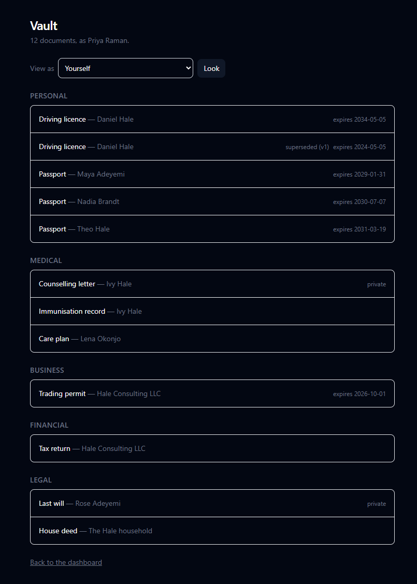
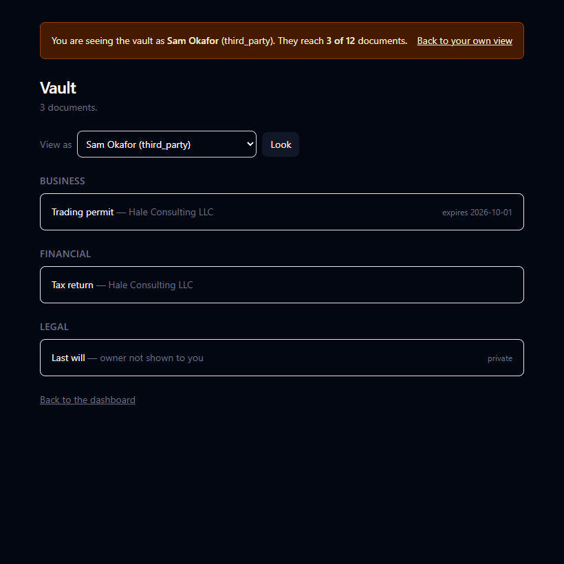
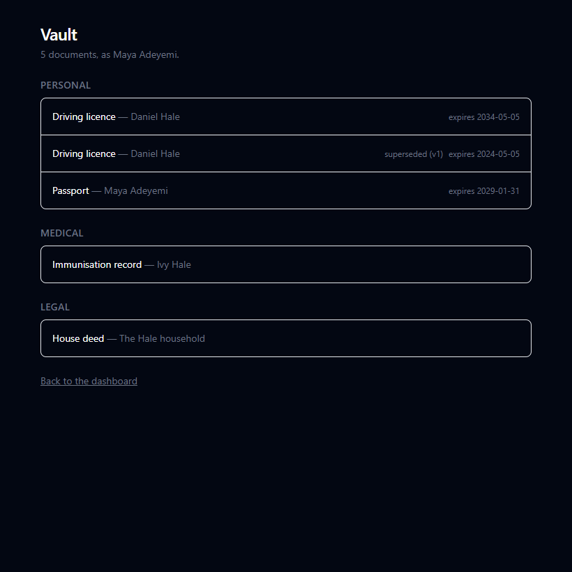
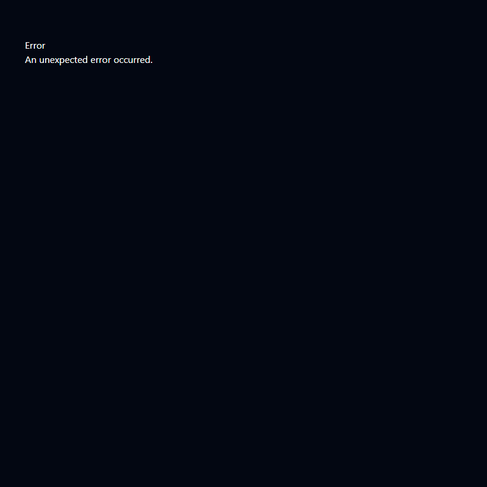

# Spec: View-as mode

Status: **closed** — landed in eight commits; every success criterion met and
seen in a browser (see Verification below). Two open questions remain, both
product decisions rather than implementation ones, and neither blocks anything
already built.
Relates to: PRODUCT.md "Resolution"; DECISIONS.md D1, D11, D21, D22, D25

## Objective

Let an admin re-render the entire vault as any other user experiences it, and
show how much of the vault that person can reach.

**Why this, and why now.** Five commits have built a permission layer that no
HTTP request has ever touched. `withVault` is imported by nothing. Four
`security definer` functions in `drizzle/0004_permission_functions.sql` answer
only to tests. View-as is the cheapest artifact that proves the layer works,
because it is the permission model with one argument changed rather than a
feature built on top of it — the database's whole notion of who is asking is
one transaction-scoped string (`app/db.server.ts:56`).

It is also, per PRODUCT.md, the thing that turns an abstract permission matrix
into something a person can check by looking.

**User.** The household admin — for now, the person who deployed this and is
about to put their family's real passports in it. The question they need
answered is not "what is Maya's role" but "what would Maya actually see."

**Success.** Signed in as admin, pick the bookkeeper, and the vault renders the
LLC's Financial and Business documents and nothing personal — with a banner
naming whose eyes these are and a count of what they reach.

## Scope

In:

- A vault list: every document the current database user may see, grouped by
  category. Unstyled beyond legibility.
- A user picker listing candidates for impersonation.
- Impersonated rendering of that list, server-side.
- A persistent banner: whose view this is, how to leave, and "N of M documents".
- An exit path back to the admin's own view.

Out, and why:

- **Activity logging of activations.** No write policy exists on any table
  (`0001_permission_layer.sql:22`). Adding one is a separate capability with
  its own security surface. Tracked as a successor; PRODUCT.md requires it
  before this is a finished product.
- **Denial reasons** ("Maya cannot see 22 of 36, and here is why each"). The
  highest-value successor — the reason column is where a wrong rule announces
  itself — but it needs `perm` to *explain* rather than filter, which is new
  SQL, not new UI.
- **Visual design.** `docs/DESIGN.md` does not exist. This spec does not invent
  it. Semantic HTML, minimal CSS, replaceable.
- **The family tree, search, upload, records, masking.** None are prerequisites.
- **Writes of any kind while impersonating.** See Boundaries.

## Design

### The impersonation primitive

`withVault` currently hardcodes the session user (`app/session.server.ts:84`).
It grows a sibling rather than a flag, so that impersonation is impossible to
reach by accident:

```ts
// The acting user and the viewed user, which are usually the same person.
export async function withVaultAs<T>(
  request: Request,
  work: (db: VaultTransaction, ctx: ViewContext) => Promise<T>,
): Promise<T>;

export type ViewContext = {
  actor: SignedInUser;   // who is really signed in
  viewedUserId: string;  // whose eyes the database is using
  isViewingAs: boolean;  // viewedUserId !== actor.id
};
```

### The gate, and why it cannot live inside the transaction

`perm.current_user_is_admin()` reads `public.current_app_user()`, which is the
setting impersonation changes. Inside an impersonated transaction the database
correctly believes you are the viewed user — so it cannot be asked whether you
were allowed to become them.

Therefore authorization runs **before** the switch, in the actor's own context:

1. Read the actor from the session cookie (`requireUser`).
2. If a viewed user is requested and `actor.role !== "admin"` → 403. Not a
   redirect, not an empty list: a refusal.
3. Only then open the vault transaction as the viewed user.

Step 2 reads `actor.role`, which comes from the auth connection
(`safehouse_auth`, D24) and not from the impersonated context. That separation
is the entire security surface of this feature and the tests target it
directly.

### The two counts

"14 of 36" is two numbers from two different user contexts: 14 as the viewed
user, 36 as the admin. They cannot come from one transaction, because the
transaction has exactly one user set. Two sequential transactions, actor first.
The admin's total is computed as the admin — not as a raw unfiltered count,
which would leak the existence of documents the admin cannot see.

### Where the viewed user lives

A URL search param on the vault route: `/vault?as=<userId>`. Not a cookie, not
server session state. Consequences, all wanted: a refresh does not silently
keep you in someone else's eyes, two tabs can hold two different views, and the
state is visible in the address bar rather than invisible and sticky.

## Tech stack

No new dependencies. React Router v7 framework mode, Drizzle for the ordinary
reads, raw SQL if a query expresses a permission rule (CLAUDE.md).

## Commands

Per CLAUDE.md; not restated here. Relevant to this work:

```
npm run dev        # http://localhost:4021, needs: docker compose up -d db
npm test           # builds safehouse_test from migrations + app/db/fixture.ts
npm run typecheck
npm run lint
```

## Project structure

As built. This section originally put `withVaultAs` on `app/session.server.ts`;
the code went elsewhere and the code was right, so the spec moved.

```
app/view-as.server.ts         the gate, the roster, both vaults  (new)
app/view-as.server.test.ts    the gate's tests, no database      (new)
app/vault.server.ts           VAULT_LIST_SQL, written once       (new)
app/db/view-as.test.ts        the list and the roster, in Postgres (new)
app/db/matrix.test.ts         the whole matrix, rendered         (new)
app/db/matrix.txt             the whole matrix, committed        (new)
app/routes/vault.tsx          the list, the picker, the banner   (new)
app/routes.ts                 route registration                 (modified)
app/auth.server.test.ts       the demoted-admin test             (modified)
vitest.config.ts              serial files, for that test        (modified)
scripts/seed-dev.mjs          a dev vault that can be signed into (new)
docs/specs/view-as.md         this file
```

`app/session.server.ts` is **unmodified**, and that is the point of the
arrangement. Impersonation lives in its own module rather than as a flag on
`withVault`, so the function every ordinary read goes through has no idea this
feature exists and cannot be made to borrow somebody's eyes by passing one
extra argument. The gate lives there too rather than in the route, so its tests
name it directly and a second impersonating surface cannot re-implement it
slightly differently.

## Code style

Match the surrounding code. Existing modules carry a header comment explaining
*why* the module exists, not what it does — `app/session.server.ts:5-13` is the
model. Comments explain reasoning and consequences; they do not narrate.

## Testing strategy

Vitest, against `safehouse_test` built from the migrations and
`app/db/fixture.ts` on every run. Per CLAUDE.md: **the test for a permission
rule is written before the rule.**

Three levels:

1. **The gate** (`app/view-as.server.test.ts`) — a non-admin requesting `?as=`
   is refused; an admin is not; a malformed or unknown user id is refused
   rather than falling through to the actor's own view.
2. **The predicate under impersonation** (landed as `app/db/view-as.test.ts`,
   not as an extension of `permissions.test.ts`) — for each of the eleven
   fixture accounts, the list the page runs returns *identically* what the
   plainest possible `select id from documents` returns in that same user's
   context. This is the assertion that makes view-as trustworthy: a view-as
   that shows something other than the truth is worse than no view-as. The
   impersonated context is not a separate code path to compare against —
   `withViewedVault` is `asUser` with a different argument — so what needs
   proving is that the joins in the list cannot widen or narrow the policies'
   answer, and that is what this asserts.
3. **A full matrix snapshot** (`app/db/matrix.test.ts`, `app/db/matrix.txt`) —
   eleven accounts by twelve documents, rendered as a text table and committed.
   The spec said six by thirty-six; the fixture is what it is, and open
   question 6 is whether to grow it. Every future permission change shows up as
   a reviewable diff in one file. This is variation #3 from the ideation
   session, kept as a test asset rather than shipped as a screen.

## Boundaries

**Always**

- Resolve permissions server-side, before the response is built (CLAUDE.md).
- Reach the vault only through `withVault`, or `withViewedVault` /
  `withActorVault` on a gated `ViewContext`.
- Write the permission test before the rule.

**Ask first**

- Any new `perm` view or `security definer` function.
- Any write policy (this spec assumes none are added).
- Any dependency.

**Never**

- Give a `perm` function a user-id parameter (D25). Impersonation changes the
  session setting; it does not parameterize the rules.
- Grant the app role USAGE on `perm`.
- Filter documents in a React component for access-control reasons.
- Perform a write while `isViewingAs` is true.
- Put real personal data in the fixture.

## Success criteria

- [x] `GET /vault` as a signed-in user lists exactly the documents
      `perm.visible_document_ids()` returns for them, grouped by category.
- [x] `GET /vault?as=<id>` as an admin renders the vault as that user.
- [x] `GET /vault?as=<id>` as a non-admin returns 403 — not an empty list, not
      a redirect.
- [x] `GET /vault?as=<unknown-or-malformed-id>` is refused, and does not fall
      through to the actor's own view.
- [x] The banner names the viewed user, shows "N of M", and offers an exit.
- [x] For all eleven fixture accounts — the criterion said six, the fixture has
      eleven — impersonated document sets equal signed-in document sets.
- [x] The committed matrix snapshot matches the fixture.
- [x] `npm test`, `npm run typecheck`, `npm run lint` pass.

## Verification, as run

Automated:

- `npm test` — 139 passing, 23 of them new (`app/view-as.server.test.ts`,
  `app/db/view-as.test.ts`, `app/db/matrix.test.ts`, and the demoted-admin test
  in `app/auth.server.test.ts`). `npm run typecheck`, `npm run lint`, `npm run
  build` all clean.
- `app/db/matrix.txt` is committed and compared on every run. Breaking the
  family privacy rule locally (dropping `not r.is_private` from
  `0001_permission_layer.sql`) moved two names in the diff — Maya and Daniel
  gained `ivyCounselling` and `roseWill`, 5→7 and 8→10 — which is what the file
  is for. Reverted.

Authenticated browser pass, against a dev database seeded by `npm run db:seed`:

| request | signed in as | answer |
| --- | --- | --- |
| `/vault` | admin (Priya) | 200, 12 documents, grouped by category |
| `/vault?as=<sam>` | admin | 200, Sam's 3 documents and the banner |
| `/vault?as=` | admin | 200, her own vault, no banner |
| `/vault?as=<her own id>` | admin | 200, her own vault, no banner |
| `/vault?as=not-a-uuid` | admin | 400 |
| `/vault?as=<unknown uuid>` | admin | 404 |
| `/vault` | individual (Maya) | 200, 5 documents, no picker rendered |
| `/vault?as=<priya>` | individual | 403 |
| `/vault?as=not-a-uuid` | individual | 403, not 400 — refused for her role before the value is read |
| `/vault?as=<sam>` | signed out | 302 to `/sign-in?next=…`, parameter preserved |

Every count matches that account's row in `app/db/matrix.txt`, which is the
point of having both.





The banner names him, says 3 of 12, and offers the way back. The will is the
per-record grant: he reaches the document without reaching its owner, so the
row reads "owner not shown to you" rather than a blank.





Two things the browser pass found that nothing else would have:

- **The banner was unreadable.** `bg-amber-50` with no text colour, in an app
  whose body is `dark:bg-gray-950` — pale yellow behind white text, in the one
  element on the page whose entire job is to say "you are not yourself right
  now". It was also the only element in the app painting its own background,
  which is why nothing else showed the problem. Fixed where it was found: the
  banner now names its own foreground and has a dark-scheme pair.
- **A refusal renders as "An unexpected error occurred".** The status is right
  (403, confirmed on the wire) and the gate's sentence is in the payload, but
  the root error boundary throws it away, so a non-admin who edits the URL is
  told nothing. Filed rather than fixed: the error boundary belongs to the
  whole app, and giving it a voice is its own piece of work, not a view-as
  change.

## Open questions

1. ~~**Can the app role list users at all?**~~ **Resolved.** `users_read`
   (`0004_permission_functions.sql:213`) is
   `id = current_app_user() or perm.current_user_is_admin()`, so an admin lists
   the full roster as `safehouse_app`. No new `perm` view needed.

   Consequence for implementation: load the picker in the **actor's**
   transaction. Inside impersonation `perm.current_user_is_admin()` is false
   and the roster collapses to the viewed user alone. It fails closed, but it
   fails confusingly, so it gets a test.
2. ~~**Is `role` on the session trustworthy for the gate?**~~ **Resolved.** Yes,
   as the auth library is configured. `getSignedInUser` calls better-auth's
   `getSession`, which reads the session row and joins the user on every
   request; no `session.cookieCache` is configured, so no copy of the role
   exists anywhere to go stale. An admin demoted in the database is refused on
   the very next request — same cookie, same session row, 403 — asserted in
   `auth.server.test.ts` ("an admin demoted mid-session can no longer borrow
   anybody's eyes"). The gate needed no change.

   That test is also the guard on the configuration, because the answer is a
   configuration and not a law. Enabling `session.cookieCache` would let the
   gate decide from a cached role for as long as the cache lives; with it
   enabled the test fails, which was checked by enabling it rather than
   assumed. The sign-in helper forwards every cookie the server set for the
   same reason: forwarding only the session token made the test pass for the
   wrong reason first time round.
3. ~~**Does an admin viewing as themselves count as view-as?**~~ **Resolved.**
   No. `gateViewAs` returns the ordinary path for `?as=<your own id>` and for
   `?as=` empty, before the admin check and before the id is validated, so
   neither becomes an impersonated transaction and neither raises a banner —
   asserted in `app/view-as.server.test.ts` ("an admin viewing as themselves is
   not viewing as anyone") and seen in the browser pass, where both return 200
   and her own vault. Falling out of the gate early also means a non-admin who
   types their own id into `?as=` is not refused for asking to be themselves.
4. **Should a per-record grant carry the owner's name?** Found while building,
   not before. Sam is granted Rose's will by name (D17), so he sees the will —
   but `ownersVisibleTo(sam)` is `["hale"]` alone, asserted deliberately in
   `permissions.test.ts`. An inner join to `owners` dropped the will off his
   list entirely; it is now a LEFT join and the page says "owner not shown to
   you".

   That is faithful to the rules as written. Whether the rules are right is a
   product question: an estate attorney handed one will who cannot see whose
   estate it is may be correct privacy or may be useless. Deciding it means
   changing `perm.visible_owner`, which is an "ask first" boundary. **Open.
   Owner: the maintainer.** Nothing is blocked on it — the page says "owner not
   shown to you", which is honest under either answer. The cost of leaving it
   is that a third party cannot tell two identically-titled documents apart.
5. **Is the admin's reach the right denominator?** **Closed by D34:** yes,
   worded "of the M you can see", and shown to admins only. The question as
   first asked: "N of M" where M is the admin's own reach reads as "of
   everything", and today that is true — admins see all, and the browser pass
   shows "3 of 12" against a fixture of exactly 12. D1 does not promise it
   stays true. If an admin ever cannot see everything, the number silently
   starts meaning something narrower, and the phrasing has to change before
   that happens rather than after. Counting M as the actor rather than as a raw
   `count(*)` is already the cautious half of this; the wording is the other
   half.
6. **Is the fixture big enough to mean anything?** **Open. Owner: the
   maintainer.** PRODUCT.md describes a household of eleven people and roughly
   36 documents; the fixture has eleven accounts and twelve documents, so this
   spec's worked example ("14 of 36") renders as "3 of 12". The rules all have
   at least one case each, which is what the permission tests need. What a
   small fixture cannot show is how any of this reads at scale: a vault list
   with no grouping pressure, a picker of eleven names that would be a scroll
   at fifty, a matrix that fits on a screen. Growing it is cheap and it churns
   `app/db/matrix.txt` once, which is the file's job.

## What comes after this

Named so the next spec starts from here rather than from scratch.

- **The activity log.** The successor this spec always pointed at, and the one
  that changes the shape of the problem: it needs the first write policy in the
  database, which is a new security surface rather than another read. When it
  lands, `withViewedVault` needs a guard on `isViewingAs` — until then, "never
  write while viewing as" is enforced by there being no write policy at all
  (`0001_permission_layer.sql`), which is a stronger guarantee than a promise
  in TypeScript but disappears the moment that file changes. Whoever adds the
  first write policy owns adding the guard in the same commit.
- **Denial reasons.** "You cannot see this because it is private to Ivy" needs
  `perm` to explain rather than filter, which is a different kind of view and
  a different risk: an explanation is itself a disclosure. Its own spec.
- **A voice for the error boundary.** Found by the browser pass: a 403 renders
  as "An unexpected error occurred" because the root boundary discards the
  response body. Small, whole-app, and not a view-as change.
- **Every next surface that lists documents** — record view, search, file
  download — states how it enforces access, in the loader, next to the query
  (CLAUDE.md). `app/routes/vault.tsx` is the model: no permission logic in the
  component, the policies decide, and the only thing the loader chooses is
  whose entitlement to use.
